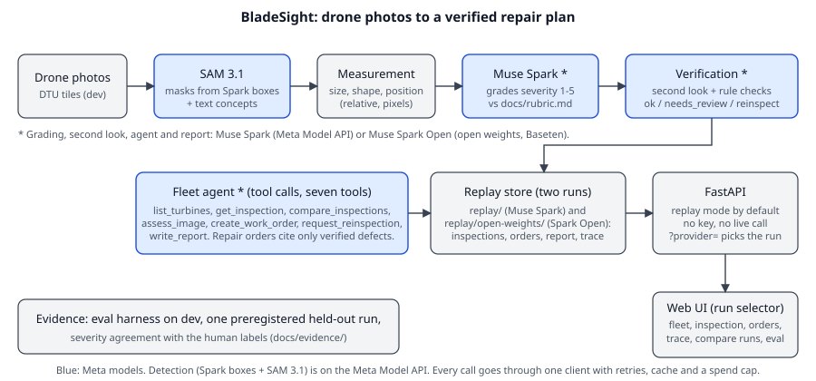

# BladeSight

Zero-shot wind turbine blade inspection: from drone photos to a **verified, prioritized repair
plan**, built on Meta **SAM 3.1** and **Muse Spark**.

> Built from scratch during the **Meta Global AI Developer Hackathon** (Oct 27 - Nov 4, 2026),
> Indie Developer track. Everything in this repository was created during the event.

- Live demo (replay mode, no login) and the video: the final links are in
  [`docs/submission/checklist.md`](docs/submission/checklist.md).
- Plan, decisions, known gaps: [`docs/plan/implementation_plan.md`](docs/plan/implementation_plan.md),
  [`docs/decision_ledger.md`](docs/decision_ledger.md), [`docs/limitations.md`](docs/limitations.md).

## What it does

Wind farm operators collect thousands of drone photos of blades and still review them by hand.
BladeSight turns inspection photos into a plan, and it says "I am not sure" instead of guessing:

1. **SAM 3.1** segments each defect and (when visible) the blade, with no training. Muse Spark
   proposes boxes for the damage and SAM 3.1 turns them into masks with box prompts, plus SAM text
   concepts ([`docs/evidence/spike.md`](docs/evidence/spike.md) explains why text alone was not enough).
2. **Measurement** gives relative size, shape and position from the mask (pixels, never
   millimetres: the photos carry no scale).
3. **Muse Spark** grades each defect 1-5 against our own illustrative rubric
   ([`docs/rubric.md`](docs/rubric.md), not an industry standard) and explains why.
4. **Verification** takes a second, independent look and runs rule checks; the result is `ok`,
   `needs_review` or `reinspect`, always with reasons.
5. **A fleet agent** (Muse Spark with tools) explains a transparent ranking score computed over
   verified defects only, compares inspections, writes work orders and a report. A work order can only cite defects with an `ok` verdict: the tool
   rejects anything else, and unverified defects can only become re-inspection requests.



## Results (every number links to its evidence file)

All detection numbers are on **dev** tiles with the frozen pipeline; the single held-out run is
described in [`eval/preregistration.md`](eval/preregistration.md) and reported in
`docs/evidence/eval_heldout.md` once it is done (see "Held-out" below).

| What | Result | Evidence |
|---|---|---|
| Damage detection, box level (IoU 0.3, 300 dev tiles) | precision 0.37 (95% CI 0.31-0.42), recall 0.22 (0.18-0.26) | [`eval_dev.md`](docs/evidence/eval_dev.md) |
| Damage, image level (a damaged 586x371 tile has at least one damage prediction) | recall 0.77, with a 21% false-alarm rate on tiles that have no box | [`eval_dev.md`](docs/evidence/eval_dev.md) |
| Dirt detection | weak (precision 0.05 on 36 boxes): reported as weak, not offered as a detector | [`eval_dev.md`](docs/evidence/eval_dev.md) |
| Severity vs a human applying the rubric (40 crops) | quadratic weighted kappa 0.12 (95% interval -0.05 to 0.29), exact agreement 25%: **advisory only** | [`severity_agreement.md`](docs/evidence/severity_agreement.md) |
| Verification on the synthetic farm (96 defects) | 33 `ok`, 50 `needs_review`, 13 `reinspect` | [`fleet_run.md`](docs/evidence/fleet_run.md) |
| Fleet agent run | 60 steps, 23 tool calls, 9 work orders (3 repair on `ok` defects, 6 re-inspections), 0.06 USD | [`fleet_run.md`](docs/evidence/fleet_run.md) |
| Cost of detection | about 0.014 USD per tile | [`detect.md`](docs/evidence/detect.md) |

How to read them honestly: most dataset boxes are about 14x14 px, so box-level recall is low for
any detector; the dev sample over-represents tiles with boxes, so precision is optimistic for a
real inspection; the severity grade agrees only weakly with the human labels, and the labels come
from one person without wind-energy experience applying our rubric, so they measure agreement with
the rubric, not specialist-validated severity. The full list is in
[`docs/limitations.md`](docs/limitations.md). Costs are documented prices times real usage, not
checked against an invoice.

## The demo farm is synthetic

The DTU photos are of **one** Nordtank turbine and carry no real turbine id or inspection year.
The demo farm (12 turbines, 2017 and 2018 inspections of 4 tiles each) is an invented grouping of
real photos, labelled as such everywhere in the app and the data. Rankings and 2017-vs-2018 trends
illustrate the method; they are not findings about a real farm.

## Run it

Replay mode (the default: no API key, no model call) serves the stored results in `replay/`:

```bash
uv sync
uv run python -m bladesight.data.demo     # streams the 2.8 GB archive, keeps only the demo tiles
(cd web && npm ci && npm run build)       # the web UI (issue #13)
uv run poe serve                          # API at http://127.0.0.1:8000 (interactive docs at /docs)
uv run python -m bladesight.api.smoke http://127.0.0.1:8000
```

Without the tiles the API still works and images answer 404 (the UI then shows "Photo unavailable"
and keeps the defect data). The UI is served at `/` when `web/dist/index.html` exists; without a
build `/` answers 404 and the API lives under `/api` and `/docs`. For UI development run the API
(`uv run poe serve`) and `uv run poe web-dev` (Vite on port 5173 proxies `/api` and `/images`).
Endpoints: [`docs/api.md`](docs/api.md).

Live mode spends money; follow [`meta-api-check`](.claude/skills/meta-api-check/SKILL.md):

```bash
cp .env.example .env   # fill META_API_KEY and META_SPEND_LIMIT_USD; never commit .env
uv run poe data                                # download, split by photo, seal the held-out split
BLADESIGHT_MODE=live uv run poe detect DJI_0382_02_04
BLADESIGHT_MODE=live uv run poe fleet process  # detect, grade and verify the farm (1.63 USD for 96 tiles, all stages)
BLADESIGHT_MODE=live uv run poe fleet run      # the agent
uv run poe check                               # lint, format, types, tests (no model call)
```

Every model call goes through one client (`src/bladesight/meta`) with retries, a disk cache and a
cumulative spend cap; tests and CI use a stub and spend nothing.

## Held-out

The dataset is split by source photo (seed 20261029); 15% of the photos form a sealed held-out
split whose hashes are in [`eval/heldout_manifest.sha256`](eval/heldout_manifest.sha256). It is read
only by one preregistered run: all 460 labeled held-out tiles plus 300 sampled clean tiles,
weighted so precision and false alarms describe the whole split, with the models, the code state
and the metrics frozen in [`eval/preregistration.md`](eval/preregistration.md). The result is
`docs/evidence/eval_heldout.md` once the run is done.

## Data

Drone inspection photos of the DTU Nordtank wind turbine (Shihavuddin & Chen, 2018, Mendeley Data,
DOI [10.17632/hd96prn3nc.2](https://doi.org/10.17632/hd96prn3nc.2), CC BY-NC 3.0), as annotated
tiles from *YOLO Annotated Wind Turbine Surface Damage* (Foster et al., 2022, CC BY-NC 4.0). No
data is stored in this repository: `uv run poe data` downloads and splits it. Sources, citations,
the licence note and the sealed held-out split: [`DATA.md`](DATA.md).

## Built during the hackathon

All code, prompts, rubric, evaluation and documentation here were written during the event. Notable
third-party libraries: FastAPI, pydantic, httpx, NumPy, Pillow, React, Vite, React Router, Vitest,
Playwright (web UI), and
[`meta-sam-parser`](https://pypi.org/project/meta-sam-parser/) (Meta Platforms, SAM License) to decode
SAM 3.1 output (a dependency, not vendored; its licence text ships with the package). The code was
written with Claude Code (the first scaffold of the web UI with Kiro, then rebuilt against the real
API); the decisions, the labels and the review are the author's, and every
decision, spend and cut is in [`docs/decision_ledger.md`](docs/decision_ledger.md).

## Models

Meta Muse Spark (`muse-spark-1.3`) and SAM 3.1 (`sam-3.1`) through the Meta Model API. Muse Spark
Open (`meta-models/muse-spark-open`, Baseten) was run on the severity gold set and is no worse than
the API on that small check (both agree only weakly with the labels) ([`open_weights.md`](docs/evidence/open_weights.md)); the agent, the
report and detection run on the API only.

## License

Code: MIT (see `LICENSE`). Data: see above.
