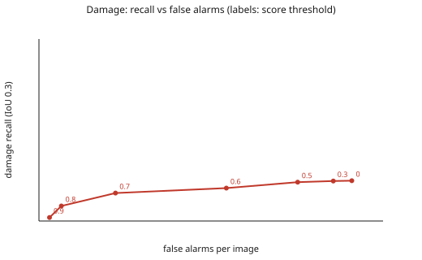

# Detection evaluation (dev)

Command: `uv run poe eval --split dev --n 300`. Split: `dev`. Tiles: 300 (176 with damage boxes, 100 with no box at all). Cost: 3.1759 USD (documented prices, not invoice-checked).

Sample: two thirds of the tiles have dataset boxes, one third none (seeded, `eval/runner.py`); the dev split is about 22% labeled, so recall is measurable but per-image false-alarm rates are not those of a real inspection (box precision and false alarms per image are optimistic for that reason; see `docs/limitations.md`). Image-level recall is per tile and location-free: read it together with the false-alarm rate on tiles with no box. The run was 1,093 live and 19 cached calls.

## Box matching (IoU 0.3 primary, 0.5 also reported)

| Class | TP | FP | FN | Precision (95% CI) | Recall (95% CI) | F1 | Recall IoU 0.5 |
|---|---|---|---|---|---|---|---|
| damage | 137 | 237 | 482 | 0.366 (0.311-0.424) | 0.221 (0.180-0.264) | 0.276 | 0.170 |
| dirt | 11 | 214 | 25 | 0.049 (0.018-0.086) | 0.306 (0.121-0.511) | 0.084 | 0.194 |

Intervals: bootstrap over tiles (1000 resamples, seed 20261029); tiles of one photo are correlated, so the intervals are probably a little too narrow. Precision is reported as 0 when there are no predictions.

## Image level and lenient overlap (damage)

- Image-level recall (a damaged tile has at least one damage prediction): **0.767** over 176 tiles.
- False-alarm rate on tiles with no box at all: **0.210** over 100 tiles.
- Truth boxes touched by any damage prediction (any overlap): **0.556** of 619.

## Threshold sweep (damage, IoU 0.3)

| Score threshold | Recall | Precision | False alarms per image |
|---|---|---|---|
| 0 | 0.221 | 0.366 | 0.790 |
| 0.3 | 0.220 | 0.379 | 0.743 |
| 0.5 | 0.213 | 0.402 | 0.653 |
| 0.6 | 0.181 | 0.441 | 0.473 |
| 0.7 | 0.153 | 0.621 | 0.193 |
| 0.8 | 0.082 | 0.750 | 0.057 |
| 0.9 | 0.019 | 0.600 | 0.027 |

## Error gallery (tile ids, damage; crops are never committed)

- `fn_no_prediction` (41): DJI_0608_07_01, DJI_0631_06_03, DJI_0200_05_04, DJI_0368_02_06, DJI_0783_02_04, DJI_0385_07_04, DJI_0604_03_05, DJI_0385_03_04, DJI_0996_06_05, DJI_0028_05_07, DJI_0394_03_04, DJI_0130_03_06 ...
- `fn_prediction_elsewhere` (46): DJI_0976_04_03, DJI_0061_08_03, DJI_0264_01_03, DJI_0445_04_03, DJI_0707_07_06, DJI_0358_02_09, DJI_0256_06_04, DJI_0680_05_07, DJI_0788_06_05, DJI_0361_06_08, DJI_0329_06_05, DJI_0443_05_06 ...
- `fn_overlap_too_low` (67): DJI_0225_03_01, DJI_0182_03_05, DJI_0013_03_05, DJI_0251_08_01, DJI_0173_03_05, DJI_0132_02_05, DJI_0973_08_05, DJI_0680_02_04, DJI_0606_01_06, DJI_0980_04_06, DJI_0778_07_05, DJI_0699_06_06 ...
- `fp_clean_tile` (21): DJI_0225_06_05, DJI_0404_08_08, DJI_0684_07_06, DJI_0601_06_06, DJI_0392_02_06, DJI_0008_01_03, DJI_0387_08_06, DJI_0781_02_07, DJI_0160_05_04, DJI_0238_06_06, DJI_0982_05_06, DJI_0378_07_06 ...
- `fp_unmatched` (113): DJI_0751_02_03, DJI_0225_03_01, DJI_0182_03_05, DJI_0013_03_05, DJI_0976_04_03, DJI_0061_08_03, DJI_0264_01_03, DJI_0251_08_01, DJI_0173_03_05, DJI_0132_02_05, DJI_0973_08_05, DJI_0680_02_04 ...

Prompt versions: {'propose': 'detect/v1', 'assess': 'assess/v1', 'verify': 'verify/v1'}. IoU levels computed: [0.1, 0.3, 0.5].
