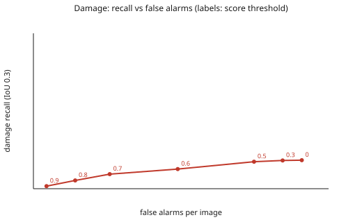

# Detection v1 on the fresh dev set (#22)

Command: `uv run poe eval --split fresh`. Split: `dev`. Tiles: 300 (170 with damage boxes, 100 with no box at all). Cost: 3.1667 USD (documented prices, not invoice-checked).

Fresh dev set of issue #22 (eval/preregistration_v2.md): 300 tiles from `eval/fresh_v2_manifest.sha256` (sha256 46ec38864cc90dd9cb7ce2eb7dd6e1e9ce0bf577c48ef187d9afb69d04e62610), every file verified; seed 20261122, two thirds labeled, photos disjoint from the tuned dev sample. Code commit 9cfd7bc1ad8516ad0801b6ea13dbcebef45e5411; run 2026-11-04T08:44:50+00:00 to 2026-11-04T09:42:25+00:00.
Calls: {'live': 1098, 'cache': 0}.

## Box matching (IoU 0.3 primary, 0.5 also reported)

| Class | TP | FP | FN | Precision (95% CI) | Recall (95% CI) | F1 | Recall IoU 0.5 |
|---|---|---|---|---|---|---|---|
| damage | 90.0 | 225.0 | 400.0 | 0.286 (0.235-0.342) | 0.184 (0.138-0.238) | 0.224 | 0.135 |
| dirt | 10.0 | 197.0 | 27.0 | 0.048 (0.022-0.081) | 0.270 (0.133-0.414) | 0.082 | 0.189 |

Intervals: bootstrap over tiles (1000 resamples, seed 20261029); tiles of one photo are correlated, so the intervals are probably a little too narrow. Precision is reported as 0 when there are no predictions.

## Image level and lenient overlap (damage)

- Image-level recall (a damaged tile has at least one damage prediction): **0.729** over 170 tiles.
- False-alarm rate on tiles with no box at all: **0.210** over 100 tiles.
- Truth boxes touched by any damage prediction (any overlap): **0.522** of 490.

## Threshold sweep (damage, IoU 0.3)

| Score threshold | Recall | Precision | False alarms per image |
|---|---|---|---|
| 0 | 0.184 | 0.286 | 0.750 |
| 0.3 | 0.182 | 0.299 | 0.697 |
| 0.5 | 0.173 | 0.315 | 0.617 |
| 0.6 | 0.127 | 0.339 | 0.403 |
| 0.7 | 0.094 | 0.418 | 0.213 |
| 0.8 | 0.053 | 0.426 | 0.117 |
| 0.9 | 0.016 | 0.421 | 0.037 |

## Error gallery (tile ids, damage; crops are never committed)

- `fn_no_prediction` (46): DJI_0007_02_04, DJI_0023_04_06, DJI_0027_04_07, DJI_0091_04_04, DJI_0095_02_03, DJI_0104_02_03, DJI_0104_06_05, DJI_0120_08_04, DJI_0134_02_05, DJI_0176_03_05, DJI_0177_02_06, DJI_0184_03_01 ...
- `fn_prediction_elsewhere` (37): DJI_0044_06_07, DJI_0044_07_08, DJI_0106_05_05, DJI_0113_06_05, DJI_0184_02_05, DJI_0203_02_05, DJI_0226_02_04, DJI_0226_03_01, DJI_0277_03_03, DJI_0323_05_05, DJI_0328_02_07, DJI_0332_03_07 ...
- `fn_overlap_too_low` (69): DJI_0041_04_05, DJI_0041_04_06, DJI_0044_05_07, DJI_0048_07_03, DJI_0095_05_04, DJI_0101_05_05, DJI_0120_08_05, DJI_0122_08_06, DJI_0127_05_06, DJI_0128_03_06, DJI_0162_02_05, DJI_0165_02_05 ...
- `fp_clean_tile` (21): DJI_0007_07_04, DJI_0027_03_05, DJI_0031_05_04, DJI_0088_01_03, DJI_0121_08_09, DJI_0158_05_05, DJI_0179_06_06, DJI_0180_06_06, DJI_0216_04_04, DJI_0218_04_04, DJI_0254_02_06, DJI_0257_04_03 ...
- `fp_unmatched` (110): DJI_0041_04_05, DJI_0041_04_06, DJI_0044_05_07, DJI_0044_06_07, DJI_0044_07_08, DJI_0048_07_03, DJI_0090_02_03, DJI_0095_05_04, DJI_0101_05_05, DJI_0106_05_05, DJI_0120_08_05, DJI_0127_05_06 ...

Prompt versions: {'propose': 'detect/v1', 'assess': 'assess/v1', 'verify': 'verify/v1', 'postprocess': 'detect-post/v1'}. IoU levels computed: [0.1, 0.3, 0.5].
