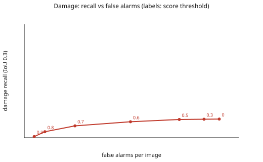

# Detection evaluation (heldout)

Command: `uv run poe eval --split heldout`. Split: `heldout`. Tiles: 760 (368 with damage boxes, 300 with no box at all). Cost: 3.8623 USD (documented prices, not invoice-checked).

Preregistered sample of the held-out split: all 460 labeled tiles plus 300 of its 1568 clean tiles (seed 20261104); each clean tile weighs 5.23, so precision, false positives and false alarms per image are scaled to the whole split. Recall and image-level rates are not affected. Unweighted damage counts at IoU 0.3: TP 216, FP 529, FN 1098. Preregistration sha256 cef25034242668ce81e7e27252e64330efc53bd81498f664fa47017439b4f3e9. Code commit ade7d9cc469a845ca671b56e50d3750321faee6b (no uncommitted changes in src/, pyproject.toml, uv.lock or the preregistration). Models muse-spark-1.3 and sam-3.1, reasoning effort low, store false (checked against the preregistered values before the run).

## Box matching (IoU 0.3 primary, 0.5 also reported)

| Class | TP | FP | FN | Precision (95% CI) | Recall (95% CI) | F1 | Recall IoU 0.5 |
|---|---|---|---|---|---|---|---|
| damage | 216.0 | 939.0 | 1098.0 | 0.187 (0.152-0.222) | 0.164 (0.136-0.194) | 0.175 | 0.134 |
| dirt | 47.0 | 879.2 | 60.0 | 0.051 (0.036-0.067) | 0.439 (0.345-0.526) | 0.091 | 0.318 |

Intervals: bootstrap over tiles (1000 resamples, seed 20261029); tiles of one photo are correlated, so the intervals are probably a little too narrow. Precision is reported as 0 when there are no predictions.

## Image level and lenient overlap (damage)

- Image-level recall (a damaged tile has at least one damage prediction): **0.698** over 368 tiles.
- False-alarm rate on tiles with no box at all: **0.240** over 300 tiles.
- Truth boxes touched by any damage prediction (any overlap): **0.504** of 1314.

## Threshold sweep (damage, IoU 0.3)

| Score threshold | Recall | Precision | False alarms per image |
|---|---|---|---|
| 0 | 0.164 | 0.187 | 0.463 |
| 0.3 | 0.163 | 0.198 | 0.427 |
| 0.5 | 0.161 | 0.220 | 0.368 |
| 0.6 | 0.141 | 0.266 | 0.252 |
| 0.7 | 0.104 | 0.360 | 0.120 |
| 0.8 | 0.053 | 0.410 | 0.049 |
| 0.9 | 0.010 | 0.214 | 0.024 |

## Error gallery (tile ids, damage; crops are never committed)

- `fn_no_prediction` (111): DJI_0006_02_04, DJI_0006_02_05, DJI_0006_04_05, DJI_0015_03_03, DJI_0016_03_03, DJI_0018_02_04, DJI_0025_04_03, DJI_0025_04_06, DJI_0026_02_03, DJI_0026_02_04, DJI_0026_03_02, DJI_0026_04_06 ...
- `fn_prediction_elsewhere` (87): DJI_0025_04_07, DJI_0039_04_05, DJI_0039_05_06, DJI_0040_05_05, DJI_0040_05_06, DJI_0089_02_03, DJI_0094_01_03, DJI_0099_01_02, DJI_0110_01_04, DJI_0112_01_04, DJI_0116_07_05, DJI_0116_07_07 ...
- `fn_overlap_too_low` (131): DJI_0006_02_06, DJI_0006_03_05, DJI_0012_03_05, DJI_0015_03_04, DJI_0016_03_04, DJI_0018_03_04, DJI_0020_03_04, DJI_0025_03_02, DJI_0025_03_03, DJI_0026_03_03, DJI_0039_04_04, DJI_0040_04_04 ...
- `fp_clean_tile` (72): DJI_0012_02_07, DJI_0012_02_08, DJI_0015_03_05, DJI_0016_02_03, DJI_0016_06_03, DJI_0018_02_05, DJI_0018_02_07, DJI_0020_03_05, DJI_0020_06_04, DJI_0025_06_03, DJI_0040_08_05, DJI_0100_05_06 ...
- `fp_unmatched` (224): DJI_0006_02_06, DJI_0006_03_05, DJI_0012_03_05, DJI_0015_03_04, DJI_0016_03_04, DJI_0018_03_04, DJI_0020_03_04, DJI_0025_03_02, DJI_0025_03_03, DJI_0025_04_07, DJI_0026_03_03, DJI_0039_04_04 ...

Prompt versions: {'propose': 'detect/v1', 'assess': 'assess/v1', 'verify': 'verify/v1'}. IoU levels computed: [0.1, 0.3, 0.5].

## Deviations from the preregistration

- **One transient API failure, resumed (preregistration step 5).** The first start of the run
  (Nov 3, 20:28 COT) stopped after about 1,380 live calls with an HTTP 404 `model_not_found` from
  the Meta API (request id `ca636e92-3202-4c9b-ac69-bf563fb8b451`). Two minimal probes right
  afterwards showed both `muse-spark-1.3` and `sam-3.1` answering, so it was treated as an
  infrastructure failure. The same command was repeated at 21:47 COT: the cache replayed the
  1,381 finished calls and 1,402 more were made live. The code, the sample, the models and the
  settings were not changed between the two starts (same commit, clean tree, same preregistration
  hash); no tile was dropped or re-drawn.
- **Cost.** The 3.8623 USD printed above is only the live calls of the resumed process. The whole
  run cost 8.07 USD (first start about 4.21 USD for about 1,383 live calls, resumed 3.86 USD for 1,402),
  summed from `.spend/spend_log.jsonl` between 20:28 and 22:51 COT with documented prices; it
  includes the two minimal probes (well under 0.01 USD). The preregistered budget was about 8 USD
  with an 11 USD ceiling.
- No code bug was fixed during the run; nothing was tuned after seeing the result.

## How this compares with the dev run (read before quoting)

Damage precision is 0.187 here against 0.37 on dev, and recall 0.164 against 0.22. The unweighted
held-out precision (TP 216, FP 529) is 0.29, so part of the drop is real and not only a weighting
effect. The dev sample
over-represents tiles with boxes, while the held-out precision is weighted to the whole split
(each sampled clean tile stands for 5.23), so the two precisions answer different questions and
the held-out one is the honest estimate for an inspection where most tiles are clean. Image-level
recall (0.698 against 0.77) and the false-alarm rate on clean tiles (0.240 against 0.21) are not
affected by the weighting, and both are a little worse than on dev. Dirt precision (0.051) is as
weak as on dev. Nothing here was tuned on held-out data.
